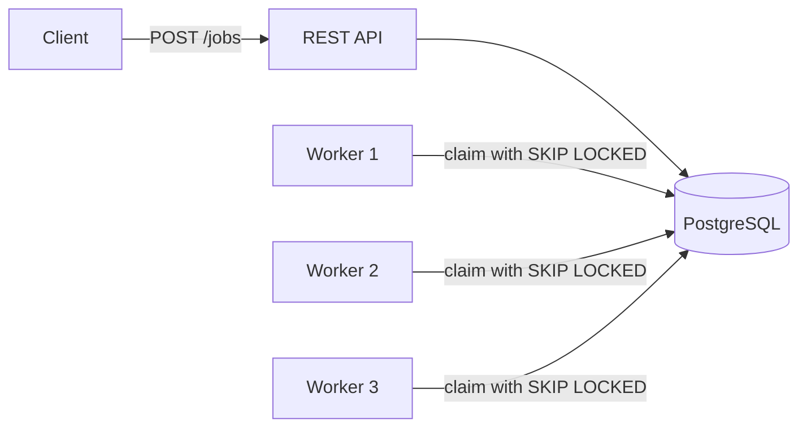

# Distributed Job Queue


A background job processing system built with Java and Spring Boot.
Clients submit jobs through a REST API. Workers pick them up, run them, and retry failures automatically.
Multiple workers can run at the same time without ever running the same job twice.

## Features

- REST API to create, view and list jobs
- Background workers that poll for ready jobs
- Safe concurrent claiming with PostgreSQL `FOR UPDATE SKIP LOCKED`
- Automatic retries with exponential backoff and jitter (2s, 4s, 8s... capped at 5 min)
- Dead jobs: after `maxAttempts` failures, a job is marked `DEAD` with its last error
- Crash recovery: if a worker dies mid-job, its lease expires and another worker takes over
- Pluggable job types using the Strategy pattern (add a class, no worker changes)
- Validation and clear error responses (RFC 9457 Problem Details)

## Tech stack

Java 21 · Spring Boot 4 · Spring Data JPA · PostgreSQL · Flyway · JUnit 5 · AssertJ

## How it works



**Job lifecycle**

```
PENDING → RUNNING → SUCCEEDED
              ↓
           FAILED → (wait, then retry) → RUNNING ...
              ↓
            DEAD  (after maxAttempts)
```

**Claiming a job.** Each worker runs this query every second:

```sql
SELECT * FROM jobs
WHERE run_at <= now()
  AND (status IN ('PENDING','FAILED')
       OR (status = 'RUNNING' AND locked_until < now()))
ORDER BY priority DESC, run_at
LIMIT :limit
FOR UPDATE SKIP LOCKED
```

`SKIP LOCKED` means that if another worker has already locked a row, this worker skips it instead of waiting.
So each worker gets different jobs, with no blocking and no duplicates.

The database lock is only held for a moment. After claiming, the job is marked `RUNNING` with a lease (`locked_until`).
If the worker crashes, the lease expires and the job becomes claimable again.

## Design decisions

**Why PostgreSQL instead of Kafka or RabbitMQ?**
Jobs and their state live in one database, so creating a job and its status are always consistent.
It's also simpler to run. At much higher volumes (tens of thousands of jobs per second), a dedicated message broker would make more sense.

**Why exponential backoff with jitter?**
If a downstream service is down, retrying every second makes it worse. Waiting longer each time gives it room to recover.
Jitter spreads retries out so many failed jobs don't all retry at the same instant.

**Why is the database lock released before the job runs?**
Jobs can take minutes. Holding a database lock that long would tie up connections. The `RUNNING` status plus a lease does the same job without the cost.

## Results

- 3 workers processed 100 jobs concurrently. Every job ran exactly once (verified with `attempts = 1` on all jobs).
- Automated test: 5 threads claim 200 jobs at the same time. The test checks all 200 were claimed and none twice.

## API

| Method | Endpoint | Description |
|---|---|---|
| POST | `/jobs` | Create a job |
| GET | `/jobs/{id}` | Get one job |
| GET | `/jobs?status=PENDING` | List jobs, optionally by status |

**Example**

```json
POST /jobs
{
  "type": "SEND_EMAIL",
  "payload": { "to": "user@example.com" },
  "priority": 1,
  "maxAttempts": 3
}
```

## Running locally

**Requirements:** Java 21, PostgreSQL

1. Create two databases: `jobqueue` and `jobqueue_test`
2. Set an environment variable `DB_PASSWORD` with your Postgres password
3. Run:
   ```
   ./mvnw spring-boot:run
   ```
4. Run tests:
   ```
   ./mvnw test
   ```

To run more workers, start more copies with a different port, e.g. `SERVER_PORT=8081`.

## What I'd add next

- Metrics (queue depth, failure rate, processing time) with Prometheus and Grafana
- Docker Compose setup
- Load testing to measure throughput
- Idempotency keys so a client can safely resend the same job